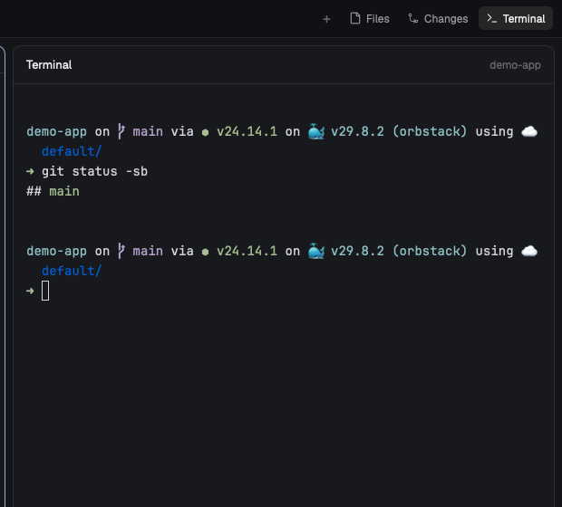

# herdr-space-terminal

A [Herdr](https://herdr.dev) desktop app mod that adds a **Terminal** button next to Files and Changes. It opens a shell for the Space you're in, in the side panel.



When an agent asks you to run something yourself (a login, a `sudo`, a quick `git` check), or you just want a prompt next to Claude, you don't have to open a whole new tab. Click Terminal and you're in a shell at the project's root.

- **One shell per Space.** Each Space gets its own, started at the git root of the folder the Files panel shows. Switching Space switches shell.
- **It stays.** The shell keeps running when you close the panel, switch Space or quit the window. `exit` gives you a fresh shell.
- **It's out of the way.** It doesn't appear as a tab or in the agents list, and each Space remembers whether its panel was open, like Files.
- **Remote Spaces work.** A Space on another machine gets its shell on that machine.

## Install

A mod only runs while a layout hosts it, and Herdr's shipped layouts and mods are read-only, so this needs a personal copy of your layout and of the tab bar.

1. Copy `mods/space-terminal/` to `~/.config/herdr-app/mods/`.
2. If you don't already use a personal layout, duplicate one. This also switches to the copy:

   ```sh
   herdr-app do layout.clone '{"name":"main","as":"my-layout"}'
   ```

3. In `~/.config/herdr-app/layouts/my-layout.json`, add the Terminal card as a third child of the `panel-body` stack, after `files` and `changes`:

   ```json
   {
     "id": "terminal", "type": "column", "radius": 10, "border": { "width": 1, "color": "border" }, "background": "background",
     "children": [
       { "id": "terminal-head", "type": "block", "size": { "px": 42 }, "content": { "mod": "space-terminal", "props": { "header": true } } },
       { "id": "terminal-body", "type": "block", "content": { "mod": "space-terminal", "props": { "placeholder": true } } }
     ]
   }
   ```

   And add this to the root node. It renders nothing; it keeps the card pointed at the right Space's shell:

   ```json
   "floating": [
     { "id": "space-terminal", "content": { "mod": "space-terminal" }, "edge": "bottom", "align": "end" }
   ]
   ```

   If you already have a `floating` list, add the entry to it.

4. Duplicate the tab bar, then point your layout's `"mod": "tabs"` at `my-tabs`:

   ```sh
   herdr-app do mod.clone '{"name":"tabs","as":"my-tabs"}'
   ```

5. In `~/.config/herdr-app/mods/my-tabs/main.js`, replace the `const enabled = ...` line with:

   ```js
   const hasTerminal = Boolean(find(root, "terminal")); // space-terminal mod's panel slot
   const enabled = [...(shared("workspace.panels") ?? ["files", "changes"]), ...(hasTerminal ? ["terminal"] : [])];
   ```

   and after the line that adds the Changes button, add:

   ```js
   .when(hasTerminal, el => el.child(panelButton("terminal", "Terminal", "mods/space-terminal/terminal.svg")))
   ```

6. Run `herdr-app check ~/.config/herdr-app/mods/space-terminal` and `herdr-app check ~/.config/herdr-app/mods/my-tabs`.

Your copies won't pick up future Herdr changes to `main` or `tabs`.

## Limits

- Switching Space with the Terminal panel open rewrites your layout file, and the previous Space's shell shows for up to half a second.
- If a Space's shell is killed outright (`hc kill`), Herdr removes the card from the layout. The mod puts it back and starts a new shell within a second.
- The folder is picked when the shell starts. Later `cd`s in the shell are kept, but the title bar keeps showing the starting folder.
- Shells are started with `sh -c` around your `$SHELL`, so `exit` restarts rather than closes. To end one, use `hc kill <address>`; opening the panel again starts a new one.

## Tests

```sh
cd mods/space-terminal && node layout.test.mjs
```
