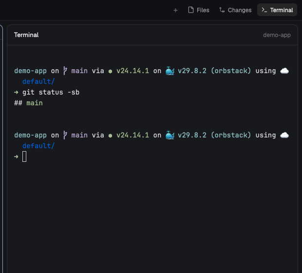

# Space Terminal

A Terminal button beside Files and Changes opens a shell for the shown Space, in the side panel, framed like the other panels. It's for quick commands an agent asks you to run, without opening a tab.

## What you see

- A `Terminal` button in the tab bar after `Changes`, with a `>_` icon. Selected, it uses the same pill as Files and Changes.
- In the side panel, a card like Files and Changes: radius 10, 1px `border` color, `background` fill.
  - Title bar 42px: `Terminal` (semibold, 13px) on the left, the shell's starting folder name (12px, `dim`) on the right, `border` line under it.
  - Below it, the live shell. Until one exists: `Starting terminal…` centered in `dim`.

## How it behaves

- One shell per Space, kept in shared state `space-terminal` as `{ [spaceId]: address }`. The starting folder of each is in `space-terminal.folders` as `{ [address]: folder }`.
- Starting folder: the focused pane's folder, else the first pane with a folder in the Space, else the Space's folder, else home. Then `git rev-parse --show-toplevel` from there, if it's a repo.
- Started with `hc run --bg --keep --no-parent --label space-terminal=<space id>`, plus `--on <machine>` for a remote Space. It has no `herdr.space`/`herdr.tab` labels, so it never becomes a tab.
- The command is `sh -c 'while :; do "${SHELL:-/bin/sh}" -l || sleep 1; done'`: `exit` gives a fresh shell and the terminal never ends.
- Every 500 ms, while the panel shows Terminal, the hidden copy checks that `terminal-body` shows the Space's shell. If not, it starts one when needed and `layout.set`s the block to `{ "terminal": <address> }`. A shown shell is checked to still be live every 3 s.
- Panel open/closed per Space comes from the tab bar's own per-space memory, with `terminal` added to its enabled panels.
- No keys.

## Built from

- Layout: a clone of `main`, with a third `panel-body` child: column `terminal` (radius 10, border, background) holding block `terminal-head` (42px, mod `space-terminal`, `{ header: true }`) and block `terminal-body` (mod `space-terminal`, `{ placeholder: true }`, swapped to a terminal at run time). A root `floating` entry hosts the hidden copy: `{ "id": "space-terminal", "content": { "mod": "space-terminal" }, "edge": "bottom", "align": "end" }`.
- Tab bar: a clone of `tabs` with the Terminal `panelButton` and `terminal` added to its enabled panels when the layout has the slot.
- Mod `space-terminal`, `mod.json` `{ "place": "none" }`:
  - `layout.js`: pure tree helpers (`find`, `repair`, the slot's shape), tested by `layout.test.mjs` under Node.
  - `main.js`: `View` with `cx.timer.every(500, sync)` in the hidden copy; renders the title bar, the placeholder, or nothing.
  - `terminal.svg`: the button icon.
- `herdr` functions: `spaces()`, `panes()`, `focused()`, `layout()`, `run("layout.set")`, `hc()`, `exec("git")`, `home()`, `shared`/`setShared`, `theme()`.

## Watch out

- When a layout terminal block's terminal ends, Herdr removes the block and folds a single-child column around it into that child. Here that loses the `panel` node, which the tab bar needs. `repair()` rebuilds the slot and the `panel` column, moving `size`/`min`/`max` back onto it.
- `layout.set` takes the whole tree. Build it from `layout()` (current clicks: shown/hidden, active child), never from the layout file, or the panel snaps back to its saved state.
- Each mod copy has its own `localStorage`, so the copies share state through `shared`.
